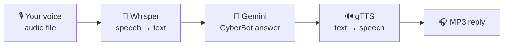

<!-- Speech Toolkit · README by Usama Shahid (fewgets) -->
<div align="center">


<p>
  
  
  
  
  
</p>

</div>

---
## 📌 Overview

**Speech Toolkit** is a small, clean **voice-AI backend** built with **FastAPI**. It gives any app
four ready-made endpoints to **listen, think and talk**:

| | Capability | Powered by |
|:-:|---|---|
| 🎙️ | **Speech → Text** | OpenAI **Whisper** (runs locally, no API cost) |
| 🔊 | **Text → Speech** | Google **gTTS** |
| 💬 | **Text → AI answer** | Google **Gemini 2.5 Flash** ("CyberBot", a cybersecurity assistant) |
| 🔁 | **Speech → Speech** | Whisper → Gemini → gTTS: ask a question out loud and hear the answer |

Plug it into a website, chatbot or mobile app to add a voice assistant in minutes.

---

## 🔁 Speech-to-Speech Pipeline



---

## 🔌 API Endpoints

| Method | Endpoint | Input | Output |
|---|---|---|---|
| `GET` | `/` | | Welcome message |
| `POST` | `/stt` | `file`: audio (WAV, MP3…) | `{ "text": "..." }` |
| `POST` | `/tts` | `text`: form field | MP3 audio stream |
| `POST` | `/text_response` | `text`: form field | `{ "response": "..." }` |
| `POST` | `/sts` | `file`: audio question | MP3 audio answer |

Interactive docs: **http://127.0.0.1:8000/docs**

---

## 🚀 Run Locally

```bash
git clone https://github.com/fewgets/SpeechTollkit.git
cd SpeechTollkit

python -m venv .venv
.venv\Scripts\activate          # macOS / Linux: source .venv/bin/activate
pip install -r requirements.txt
```

Set your Gemini API key ([get one free](https://aistudio.google.com/)):

```bash
# Windows (PowerShell)
$env:GEMINI_API_KEY="your-key"
# macOS / Linux
export GEMINI_API_KEY="your-key"
```

Start the server:

```bash
uvicorn api:app --reload
```

### 🧪 Try it

```bash
# Speech → Text (a sample file is included)
curl -X POST -F "file=@harvard.wav" http://127.0.0.1:8000/stt

# Text → Speech
curl -X POST -F "text=Hello from Speech Toolkit" http://127.0.0.1:8000/tts --output hello.mp3

# Ask the AI by voice and get a spoken answer
curl -X POST -F "file=@harvard.wav" http://127.0.0.1:8000/sts --output answer.mp3
```

---

## 📁 Project Structure

```text
SpeechToolkit/
├── api.py              # FastAPI app and endpoints
├── stt.py              # Whisper speech-to-text (CPU, 16 kHz mono)
├── tts.py              # gTTS text-to-speech (in-memory MP3)
├── text_response.py    # CyberBot: Gemini chat wrapper
├── sts.py              # Full voice pipeline
├── test.py             # Bonus: local LLM chat server via Ollama
├── harvard.wav         # Sample audio for testing
└── requirements.txt
```

---

## 🧰 Tech Stack

| Component | Technology |
|---|---|
| API | FastAPI, Uvicorn |
| Speech-to-Text | OpenAI Whisper (`base` model), SoundFile, Librosa, PyTorch |
| LLM | Google Gemini 2.5 Flash (`google-genai`) |
| Text-to-Speech | gTTS |
| Local LLM (optional) | Ollama |

## 🔭 Roadmap

- [ ] Streaming responses for lower latency
- [ ] Urdu and multilingual voices
- [ ] Conversation memory across turns
- [ ] Swap gTTS for a neural TTS voice

---

## 🤝 Let's Work Together

<div align="center">

**Have an idea, a freelance project, or want to collaborate on something in AI?**
I'm always open to collaborations, freelance work and full-time opportunities.

<a href="mailto:shaikhusama541@gmail.com?subject=Collaboration%20-%20Speech%20Toolkit">
  
</a>
<a href="https://www.linkedin.com/in/-usamashahid/">
  
</a>
<a href="https://github.com/fewgets">
  
</a>

<br/><br/>

⭐ **If you like this project, please give it a star. It really helps!** ⭐

<br/>

<h3>"The most natural interface is your own voice."</h3>


</div>
